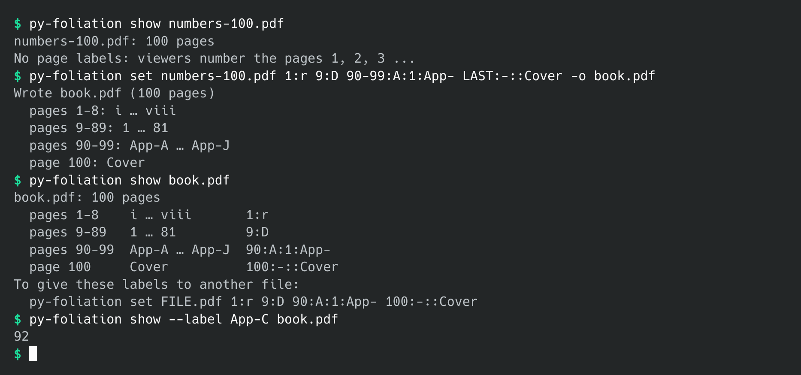

# py-foliation

*[Leer en español](https://github.com/nivaca/py-foliation/blob/main/README_es.md)*

py-foliation changes the **page labels** of PDF documents: the numbering a PDF
viewer shows for their pages. A book whose front matter is numbered i, ii,
iii … and whose text starts again at 1 can show those numbers in the viewer,
instead of the plain 1, 2, 3 … of the pages of the file. Only the labels
change; the pages themselves are left as they are.

It has a window, for seeing and editing the labels page by page, and a
command line, for doing the same in scripts.

## Installation

There are three ways to install it: the AppImage (nothing to install), the
Fedora package, or from the source.

### AppImage (any Linux)

Download `py-foliation-VERSION-x86_64.AppImage` from the
[releases](https://github.com/nivaca/py-foliation/releases), make it
executable, and run it. It holds its own Python, Qt and everything else, and
runs on Linux with glibc 2.34 or later (Ubuntu 22.04, Debian 12, Fedora 35 and
later).

```bash
chmod +x py-foliation-*-x86_64.AppImage
./py-foliation-*-x86_64.AppImage                   # the window
./py-foliation-*-x86_64.AppImage show book.pdf     # the command line
./py-foliation-*-x86_64.AppImage cli --help        # the list of commands
```

A first argument that is a command (`show`, `set`…), an option, or `cli`
runs the command line; anything else, or nothing, opens the window. Tools
such as AppImageLauncher or Gear Lever add it to the applications menu.

### Fedora (Copr)

```bash
sudo dnf copr enable nivaca/py-foliation
sudo dnf install py-foliation
```

This installs `py-foliation`, `py-foliation-gui`, a menu entry (also offered
for opening PDF files) and the icons, using Fedora's own Python, pikepdf and
PySide6. Updates come with `sudo dnf upgrade`. The packages are built and
signed by [Copr](https://copr.fedorainfracloud.org/coprs/nivaca/py-foliation/).

Each release also has the RPM itself, signed with the author's key, and that
key (`RPM-GPG-KEY-py-foliation`, also in the repository as
[`packaging/RPM-GPG-KEY-py-foliation`](https://github.com/nivaca/py-foliation/blob/main/packaging/RPM-GPG-KEY-py-foliation)).
Its fingerprint is `8187 0643 CA22 1AF9 0C30 554E BE68 32CD 3599 4948`:

```bash
sudo rpm --import RPM-GPG-KEY-py-foliation
sudo dnf install ./py-foliation-*.noarch.rpm
```

### From the source

You need Python 3.12+ and [uv](https://docs.astral.sh/uv/).

```bash
git clone https://github.com/nivaca/py-foliation.git    # or https://codeberg.org/nivaca/py-foliation.git
cd py-foliation
uv sync --extra gui      # without --extra gui, only the command line
uv tool install '.[gui]' # optional: makes py-foliation and py-foliation-gui available everywhere
py-foliation-install     # optional: adds the window to the applications menu
```

`py-foliation-install` works on Linux, Windows and macOS, in your own
folders; `--uninstall` removes what it added.

## The window

    py-foliation-gui [file.pdf]


Open a PDF (or drop it on the window). The window shows the **ranges** of
labels, each with its first page, its style (1, 2, 3; i, ii, iii; I, II,
III; a, b, c; A, B, C; folios 1r, 1v, 2r; or no number), the number it
starts at, a prefix and a suffix; below them, every page with its label; and
on the right, the page chosen.


- **Add a range** starts a new range at the page shown, and so does a
  double-click on a page; **Remove the range** lets the range before go on
  over its pages; **No labels** removes them all.
- Select pages in the list (with Shift and Ctrl) and right-click them to
  **number them** (in any style, from any start, with a prefix and a
  suffix), **continue the numbering from before** them, **give them one
  label**, **edit their labels one by one**, or leave them with **no
  label**.
- **View ▸ Thumbnails of the pages** shows the pages as thumbnails with
  their labels, to look over a whole book at once.
- **Go to the page labelled…** (Ctrl+L) finds a page by its label: `xii`,
  `12v`, `A-3`.
- **Edit ▸ Undo / Redo** go back and forth over the changes.
- **File ▸ Save** gives the file open the new labels; **Save as…** saves a
  copy with them; **Revert to the labels of the file** drops the changes.
- **File ▸ Copy the labels of another PDF…** takes them from another file,
  for instance an earlier export of the same book.
- **File ▸ Labels from a list…** reads the label of every page from a text
  file, one on each line, and **Save the labels as a list…** writes one, to
  edit in any editor or spreadsheet.
- **Edit ▸ Copy command line** copies the command that gives the same labels
  to another file.

Files protected by a password ask for it, and keep their protection when
they are saved.

## The command line



    py-foliation show book.pdf                     # the ranges of labels
    py-foliation show --all book.pdf               # the label of every page
    py-foliation show --label xii book.pdf         # the page labelled xii
    py-foliation set book.pdf 1:r 9:D              # new labels -> book-labelled.pdf
    py-foliation set book.pdf 1:r 9:D -i           # change book.pdf itself
    py-foliation set *.pdf 1:r 9:D -i              # several files at once
    py-foliation set book.pdf 1:r 9:D --dry-run    # only show what it would do
    py-foliation copy old.pdf new.pdf -i           # the labels of old.pdf, to new.pdf
    py-foliation clear book.pdf -o plain.pdf       # no labels

A range is written `PAGES:STYLE[:START[:PREFIX]]`:

| Range           | Pages                     | Labels                       |
|-----------------|---------------------------|------------------------------|
| `1:r`           | from 1 on                 | i, ii, iii …                 |
| `9:D`           | from 9 on                 | 1, 2, 3 …                    |
| `201-214:A`     | 201 to 214                | A … N, then the old numbering goes on |
| `215:D:1:App-`  | from 215 on               | App-1, App-2 …               |
| `5:f:12v`       | from 5 on                 | 12v, 13r, 13v … (folios)     |
| `LAST:-::Cover` | the last page             | Cover                        |

or, with `--range`, as `PAGES [style=S] [start=N] [prefix=P] [suffix=X]`:

    py-foliation set book.pdf --range 1-8 style=roman --range 9- style=arabic
    py-foliation set book.pdf --range 1-4 style=roman 'prefix=[' 'suffix=]' 5:D

`PAGES` is a first page (`9`) or a span (`9-200`, `9..200`, `201-`); `LAST`
and `LAST-N` count from the end. A range without a last page goes on until
the next one; a span is laid over the others, and after it the pages go on
with the numbers they had.

The styles are `D` or `arabic` (1, 2, 3), `r` or `roman` (i, ii, iii), `R` or
`ROMAN` (I, II, III), `a` or `letters` (a, b, c), `A` or `LETTERS` (A, B, C),
`f` or `folio` (1r, 1v, 2r: the recto and verso of each leaf; the start is a
leaf and its side, as `12v`), and `-` or `none` (the prefix only).

`set` replaces the labels the file had; with `--keep` it changes only the
pages given, and `--remove PAGE` drops the range that starts at PAGE.
`show` prints the command that gives the labels of one file to another.
`--password` opens protected files, which keep their protection.

### Folios, suffixes and any other labels

PDF numbers pages in five styles, with a prefix. Folios, for manuscripts and
early printed books, and labels with something after the number (`[i]`,
`12bis`) are not among them: py-foliation writes those as one label for
each page, and recognises them again when it reads the file, so they are
shown and edited as ranges like any other.

Any numbering at all can be given page by page: `--from-file` (or
**File ▸ Labels from a list…**) reads the label of every page, one on each
line, and finds the fewest ranges that give them:

    py-foliation show --all book.pdf > labels.txt     # edit labels.txt…
    py-foliation set book.pdf --from-file labels.txt -i

### Completion and manual

`py-foliation completion bash|fish|zsh` prints the script that completes
commands, options and files in each shell, for instance:

    py-foliation completion fish > ~/.config/fish/completions/py-foliation.fish

The Fedora package installs them, and the manual page (`man py-foliation`).

## Language

The interface is in English and Spanish. `py-foliation interface es` (or
**Settings ▸ Interface Language** in the window) keeps the choice in
the configuration file; `--interface CODE` changes it for one run.

## Development

    uv sync --all-extras
    uv run pytest

The pictures of this README are made by `uv run python tools/screenshots.py`
(in both languages, without showing anything on the screen), and the icons by
`uv run python tools/icons.py` (with Inkscape) from
`src/py_foliation/icons/py-foliation.svg`.

The AppImage is made by `uv run python tools/bundle-appimage.py`, the signed
RPM by `packaging/build-rpm.sh --sign`, and each release, on GitHub, Codeberg
and Copr, by `uv run python tools/release.py --rpm` (see `packaging/COPR.org`);
`--pypi` also uploads it to PyPI. The manual pages are made from the help of
the command line by `uv run python tools/manpage.py` (a test checks they are
up to date). The Flatpak's manifest and Python modules are in
`packaging/flatpak/` (`tools/flatpak-deps.py` makes the modules from
`uv.lock`); `packaging/FLATHUB.org` explains how to build it and submit it.

## License

GNU General Public License, version 3 or later. By
[Nicolas Vaughan](https://nicolasvaughan.org).
