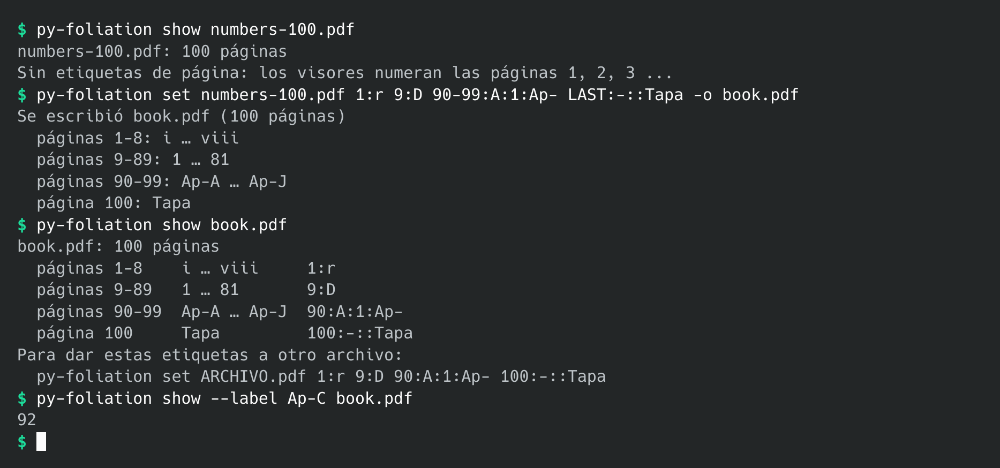

# py-foliation

*[Read in English](README.md)*

py-foliation cambia las **etiquetas de página** de documentos PDF: la
numeración que un visor de PDF muestra para sus páginas. Un libro cuyas
páginas preliminares van numeradas i, ii, iii … y cuyo texto empieza de nuevo
en 1 puede mostrar esos números en el visor, en lugar del simple 1, 2, 3 … de
las páginas del archivo. Solo cambian las etiquetas; las páginas quedan como
están.

Tiene una ventana, para ver y editar las etiquetas página por página, y una
línea de órdenes, para hacer lo mismo en scripts.

## Instalación

Hay tres formas de instalarlo: la AppImage (no hay nada que instalar), el
paquete de Fedora, o desde el código fuente.

### AppImage (cualquier Linux)

Descargue `py-foliation-VERSION-x86_64.AppImage` de las
[versiones publicadas](https://github.com/nivaca/py-foliation/releases),
hágala ejecutable y ejecútela. Lleva su propio Python, Qt y todo lo demás, y
funciona en Linux con glibc 2.34 o posterior (Ubuntu 22.04, Debian 12, Fedora
35 y posteriores).

```bash
chmod +x py-foliation-*-x86_64.AppImage
./py-foliation-*-x86_64.AppImage                    # la ventana
./py-foliation-*-x86_64.AppImage show libro.pdf     # la línea de órdenes
./py-foliation-*-x86_64.AppImage cli --help         # la lista de órdenes
```

Un primer argumento que sea una orden (`show`, `set`…), una opción o `cli`
ejecuta la línea de órdenes; cualquier otra cosa, o nada, abre la ventana.
Herramientas como AppImageLauncher o Gear Lever la añaden al menú de
aplicaciones.

### Fedora (Copr)

```bash
sudo dnf copr enable nivaca/py-foliation
sudo dnf install py-foliation
```

Esto instala `py-foliation`, `py-foliation-gui`, una entrada de menú (ofrecida
también para abrir archivos PDF) y los iconos, con el Python, pikepdf y
PySide6 del propio Fedora. Las actualizaciones llegan con `sudo dnf upgrade`.
Los paquetes los construye y firma
[Copr](https://copr.fedorainfracloud.org/coprs/nivaca/py-foliation/).

Cada versión publicada incluye además el RPM, firmado con la clave del autor,
y esa clave (`RPM-GPG-KEY-py-foliation`, también en el repositorio como
[`packaging/RPM-GPG-KEY-py-foliation`](packaging/RPM-GPG-KEY-py-foliation)).
Su huella es `8187 0643 CA22 1AF9 0C30 554E BE68 32CD 3599 4948`:

```bash
sudo rpm --import RPM-GPG-KEY-py-foliation
sudo dnf install ./py-foliation-*.noarch.rpm
```

### Desde el código fuente

Se necesita Python 3.12 o posterior y [uv](https://docs.astral.sh/uv/).

```bash
git clone https://github.com/nivaca/py-foliation.git    # o https://codeberg.org/nivaca/py-foliation.git
cd py-foliation
uv sync --extra gui      # sin --extra gui, solo la línea de órdenes
uv tool install '.[gui]' # opcional: py-foliation y py-foliation-gui disponibles en todas partes
py-foliation-install     # opcional: añade la ventana al menú de aplicaciones
```

`py-foliation-install` funciona en Linux, Windows y macOS, en sus propias
carpetas; `--uninstall` quita lo que añadió.

## La ventana

    py-foliation-gui [archivo.pdf]


Abra un PDF (o suéltelo en la ventana). La ventana muestra los **intervalos**
de etiquetas, cada uno con su primera página, su estilo (1, 2, 3; i, ii, iii;
I, II, III; a, b, c; A, B, C; o sin número), el número en que empieza y un
prefijo; debajo, cada página con su etiqueta; y a la derecha, la página
elegida.

- **Añadir un intervalo** empieza un nuevo intervalo en la página mostrada;
  **Quitar el intervalo** deja que el anterior siga sobre sus páginas;
  **Sin etiquetas** las quita todas.
- **Editar ▸ Deshacer / Rehacer** van y vienen por los cambios.
- **Archivo ▸ Guardar** da las nuevas etiquetas al archivo abierto;
  **Guardar como…** guarda una copia con ellas; **Volver a las etiquetas del
  archivo** descarta los cambios.
- **Editar ▸ Copiar línea de órdenes** copia la orden que da las mismas
  etiquetas a otro archivo.

## La línea de órdenes



    py-foliation show libro.pdf                 # los intervalos de etiquetas
    py-foliation show --all libro.pdf           # la etiqueta de cada página
    py-foliation set libro.pdf 1:r 9:D          # nuevas etiquetas -> libro-labelled.pdf
    py-foliation set libro.pdf 1:r 9:D -i       # cambiar el propio libro.pdf
    py-foliation clear libro.pdf -o simple.pdf  # sin etiquetas

Un intervalo se escribe `PÁGINAS:ESTILO[:INICIO[:PREFIJO]]`:

| Intervalo      | Páginas              | Etiquetas                    |
|----------------|----------------------|------------------------------|
| `1:r`          | desde la 1           | i, ii, iii …                 |
| `9:D`          | desde la 9           | 1, 2, 3 …                    |
| `201-214:A`    | de la 201 a la 214   | A … N, luego sigue la numeración anterior |
| `215:D:1:Ap-`  | desde la 215         | Ap-1, Ap-2 …                 |
| `LAST:-::Tapa` | la última página     | Tapa                         |

o, con `--range`, como `PÁGINAS [style=E] [start=N] [prefix=P]`:

    py-foliation set libro.pdf --range 1-8 style=roman --range 9- style=arabic

`PÁGINAS` es una primera página (`9`) o un tramo (`9-200`, `9..200`, `201-`);
`LAST` y `LAST-N` cuentan desde el final. Un intervalo sin última página sigue
hasta el siguiente; un tramo se pone sobre los demás, y después de él las
páginas siguen con los números que tenían.

Los estilos son `D` o `arabic` (1, 2, 3), `r` o `roman` (i, ii, iii), `R` o
`ROMAN` (I, II, III), `a` o `letters` (a, b, c), `A` o `LETTERS` (A, B, C), y
`-` o `none` (solo el prefijo).

`set` reemplaza las etiquetas que tenía el archivo; con `--keep` cambia solo
las páginas indicadas, y `--remove PÁGINA` quita el intervalo que empieza en
PÁGINA. `show` imprime la orden que da las etiquetas de un archivo a otro.

## Idioma

La interfaz está en inglés y en español. `py-foliation interface es` (o
**Ajustes ▸ Idioma de la interfaz** en la ventana) guarda la elección en
el archivo de configuración; `--interface CÓDIGO` la cambia para una sola
ejecución.

## Desarrollo

    uv sync --all-extras
    uv run pytest

Las imágenes de este README las hace `uv run python tools/screenshots.py`
(en los dos idiomas, sin mostrar nada en la pantalla), y los iconos
`uv run python tools/icons.py` (con Inkscape) a partir de
`src/py_foliation/icons/py-foliation.svg`.

La AppImage la hace `uv run python tools/bundle-appimage.py`, el RPM firmado
`packaging/build-rpm.sh --sign`, y cada versión, en GitHub, Codeberg y Copr,
`uv run python tools/release.py --rpm` (vea `packaging/COPR.org`).

## Licencia

GNU General Public License, versión 3 o posterior. Por
[Nicolas Vaughan](https://nicolasvaughan.org).
