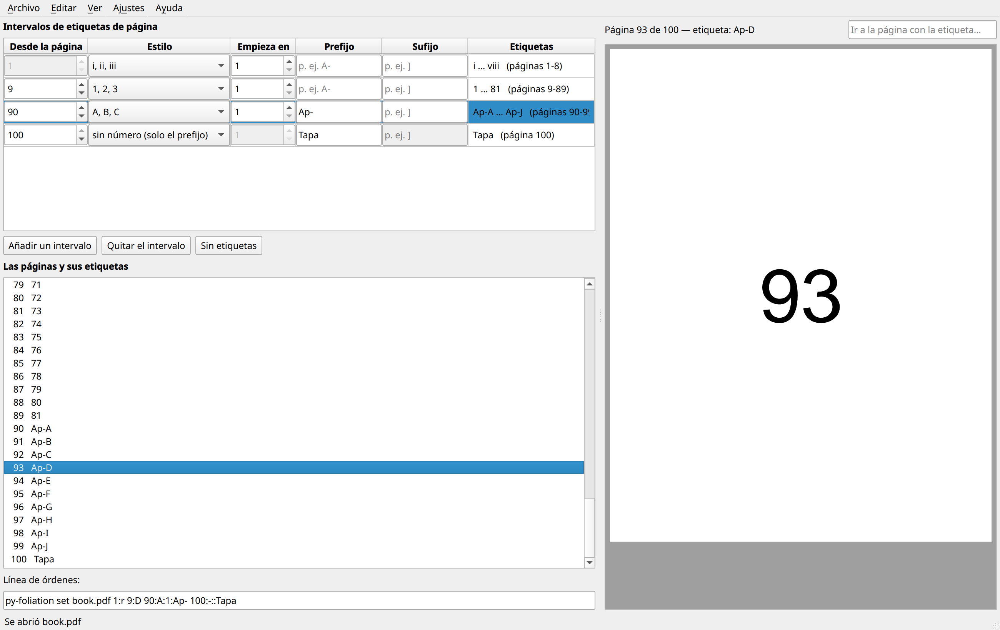
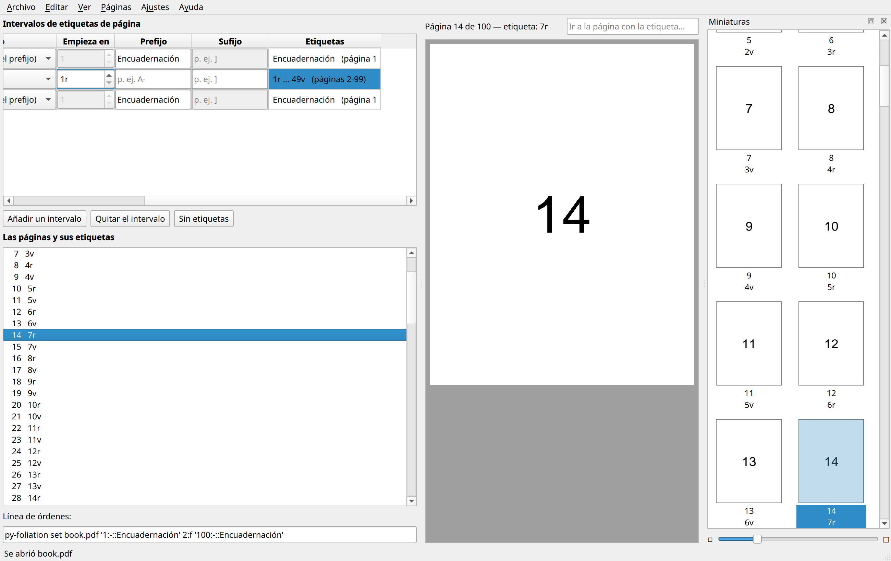

# py-foliation

*[Read in English](README.md)*

py-foliation cambia las **etiquetas de página** de documentos PDF: la
numeración que un visor de PDF muestra para sus páginas. Un libro cuyas
páginas preliminares van numeradas i, ii, iii … y cuyo texto empieza de nuevo
en 1 puede mostrar esos números en el visor, en lugar del simple 1, 2, 3 … de
las páginas del archivo. Solo cambian las etiquetas; las páginas quedan como
están.

También puede añadir encabezados y pies a las páginas (la etiqueta de la
página, su número, la fecha, números Bates o cualquier texto), y esos sí
cambian las páginas. Tiene una ventana, para ver y editar las etiquetas página por página, y una
línea de órdenes, para hacer lo mismo en scripts.

## Instalación

Hay cuatro formas de instalarlo: la AppImage (no hay nada que instalar), el
paquete de Fedora, el instalador para Python (Linux, Windows y macOS), o
desde el código fuente.

### AppImage (cualquier Linux)

Descargue `py-foliation-VERSION-x86_64.AppImage` de las
[versiones publicadas](https://github.com/nivaca/py-foliation/releases),
hágala ejecutable y ejecútela. Lleva su propio Python, Qt y todo lo demás, y
funciona en Linux con glibc 2.34 o posterior (Ubuntu 22.04, Debian 12, Fedora
35 y posteriores).

```bash
chmod +x py-foliation-*-x86_64.AppImage
./py-foliation-*-x86_64.AppImage                    # la ventana
./py-foliation-*-x86_64.AppImage show libro.pdf     # la línea de órdenes
./py-foliation-*-x86_64.AppImage cli --help         # la lista de órdenes
```

Un primer argumento que sea una orden (`show`, `set`…), una opción o `cli`
ejecuta la línea de órdenes; cualquier otra cosa, o nada, abre la ventana.
Herramientas como AppImageLauncher o Gear Lever la añaden al menú de
aplicaciones.

### Fedora (Copr)

```bash
sudo dnf copr enable nivaca/py-foliation
sudo dnf install py-foliation
```

Esto instala `py-foliation`, `py-foliation-gui`, una entrada de menú (ofrecida
también para abrir archivos PDF) y los iconos, con el Python, pikepdf y
PySide6 del propio Fedora. Las actualizaciones llegan con `sudo dnf upgrade`.
Los paquetes los construye y firma
[Copr](https://copr.fedorainfracloud.org/coprs/nivaca/py-foliation/).

Cada versión publicada incluye además el RPM, firmado con la clave del autor,
y esa clave (`RPM-GPG-KEY-py-foliation`, también en el repositorio como
[`packaging/RPM-GPG-KEY-py-foliation`](packaging/RPM-GPG-KEY-py-foliation)).
Su huella es `8187 0643 CA22 1AF9 0C30 554E BE68 32CD 3599 4948`:

```bash
sudo rpm --import RPM-GPG-KEY-py-foliation
sudo dnf install ./py-foliation-*.noarch.rpm
```

### Comprobar una descarga

Cada archivo de una versión publicada se firma con esa misma clave, y
también la etiqueta de la versión. Cada archivo va con su firma
(`ARCHIVO.asc`), y la versión trae `SHA256SUMS`, las sumas de comprobación
de todos, con su propia firma (`SHA256SUMS.asc`), y la clave,
`RPM-GPG-KEY-py-foliation`. Para comprobar una descarga, se importa la clave una
vez y luego se comprueban la firma del archivo y su suma:

```bash
gpg --import RPM-GPG-KEY-py-foliation
gpg --verify py-foliation-VERSIÓN-x86_64.AppImage.asc py-foliation-VERSIÓN-x86_64.AppImage
gpg --verify SHA256SUMS.asc SHA256SUMS && sha256sum -c --ignore-missing SHA256SUMS
```

El RPM lleva además su firma dentro, que `rpm -K` comprueba después de
`sudo rpm --import RPM-GPG-KEY-py-foliation`. La etiqueta puede comprobarse en un
clon con `git tag -v vVERSIÓN`.

### Con Python (Linux, Windows, macOS)

Los instaladores de [`installers/`](installers/) preparan py-foliation para
usarlo con su propio Python 3.14 o posterior, sin binarios propios. No
piden permisos de administrador y no tocan el Python del sistema.

Linux y macOS, en una terminal:

```bash
curl -LsSf https://raw.githubusercontent.com/nivaca/py-foliation/main/installers/install.sh | sh
```

Windows, en PowerShell:

```powershell
powershell -ExecutionPolicy ByPass -c "irm https://raw.githubusercontent.com/nivaca/py-foliation/main/installers/install.ps1 | iex"
```

El instalador busca Python 3.14 o posterior y luego:

1. hace un entorno de Python propio: en `~/.local/share/py-foliation`
   (Linux), `~/Library/Application Support/py-foliation` (macOS) o
   `%LOCALAPPDATA%\py-foliation` (Windows);
2. instala allí py-foliation con la ventana, a partir del wheel de la
   última versión (pip trae además pikepdf y PySide6);
3. deja disponibles `py-foliation` y `py-foliation-gui`: enlazados en
   `~/.local/bin` en Linux y macOS (avisa si esa carpeta no está en su PATH),
   o con su carpeta añadida al PATH en Windows (abra luego una terminal
   nueva);
4. añade la ventana al menú de aplicaciones (el menú Inicio en Windows,
   `~/Applications` en macOS).

Si falta Python 3.14, dice dónde conseguirlo: los paquetes del sistema en
Linux, [python.org](https://www.python.org/downloads/) o
`brew install python@3.14` en macOS, python.org o
`winget install Python.Python.3.14` en Windows. En Debian y Ubuntu hace
falta además `python3-venv`.

Para actualizar a la última versión, basta con ejecutarlo otra vez. Con una
copia del repositorio, los scripts pueden ejecutarse directamente, con estas
opciones:

```bash
sh installers/install.sh --version 1.0.1     # una versión determinada
sh installers/install.sh --no-gui            # solo la línea de órdenes (sin PySide6)
sh installers/install.sh --no-menu           # sin el acceso en el menú
sh installers/install.sh --uninstall         # quitarlo
python3 installers/install.py --from dist/py_foliation-1.0.1-py3-none-any.whl
```

En Windows: `powershell -ExecutionPolicy ByPass -File installers\install.ps1
--uninstall`, etc. Para pasar opciones a la orden de una línea en Linux o
macOS, se ponen tras `sh -s --`, como en `curl … | sh -s -- --uninstall`.
Desinstalarlo quita el entorno, las órdenes y el acceso del menú, y nada
más: sus ajustes y perfiles se quedan.

### Desde el código fuente

Se necesitan Python 3.14 o posterior y [uv](https://docs.astral.sh/uv/).

```bash
git clone https://github.com/nivaca/py-foliation.git    # o https://codeberg.org/nivaca/py-foliation.git
cd py-foliation
uv sync --extra gui      # sin --extra gui, solo la línea de órdenes
uv tool install '.[gui]' # opcional: py-foliation y py-foliation-gui disponibles en todas partes
py-foliation-install     # opcional: añade la ventana al menú de aplicaciones
```

`py-foliation-install` funciona en Linux, Windows y macOS, en sus propias
carpetas; `--uninstall` quita lo que añadió.

### PDF/A y PDF/X

Para guardar una copia como PDF/A o PDF/X, py-foliation usa otro programa
mío, [pdf2iso](https://github.com/nivaca/pdf2iso) (necesita
Ghostscript). py-foliation lo busca, como `pdf2iso` o
`pdf2iso.py`, en el PATH y en `~/bin` y `~/.local/bin` (o, si es anterior a su versión 2.0, como `py-pdfconform` o `py-pdfconform.py`); un programa
abierto desde el menú del escritorio a menudo no tiene esas dos carpetas en
su PATH. Si está en otra parte, se indica su ruta en *Ajustes ▸
pdf2iso…*, que dice cuál se usará (queda como `pdfconform` en el
archivo de configuración, que también lee la línea de órdenes). Un script
que no puede ejecutarse por sí mismo se ejecuta con `python3`. Sin él, esas
opciones aparecen desactivadas y todo lo demás funciona.

La conversión conserva las etiquetas de página y la vista al abrir el
archivo. Ghostscript, eso sí, escribe las páginas de nuevo: en la copia, los
encabezados, pies y marcas de agua que añadió py-foliation pasan a ser parte
de las páginas, y ya no pueden actualizarse ni quitarse. PDF/A y PDF/X no
admiten contraseña, así que la copia de un archivo protegido sale sin ella.

## La ventana

    py-foliation-gui [archivo.pdf]



Abra un PDF (o suéltelo en la ventana). La ventana muestra los **intervalos**
de etiquetas, cada uno con su primera página, su estilo (1, 2, 3; i, ii, iii;
I, II, III; a, b, c; A, B, C; folios 1r, 1v, 2r; o sin número), el número en
que empieza, un prefijo y un sufijo; debajo, cada página con su etiqueta; y a
la derecha, la página elegida.



- **Añadir un intervalo** empieza un nuevo intervalo en la página mostrada, y
  también un doble clic en una página; **Quitar el intervalo** deja que el
  anterior siga sobre sus páginas; **Sin etiquetas** las quita todas.
- Seleccione páginas en la lista (con Mayús y Ctrl) y haga clic derecho en
  ellas para **numerarlas** (en cualquier estilo, desde cualquier inicio, con
  prefijo y sufijo), **seguir la numeración anterior**, **darles una sola
  etiqueta**, **editar sus etiquetas una por una** o dejarlas **sin
  etiqueta**.
- El mismo menú establece cómo muestran los visores el documento al abrirlo
  (para todo el documento: PDF no tiene otra manera). **Disposición de
  página**: Una página, Una página continua, Páginas enfrentadas (dos páginas
  una junto a otra, las impares a la izquierda), Páginas enfrentadas
  continuas, Portada (como Páginas enfrentadas, con la primera página sola,
  como la portada de un libro) o Portada continua; **Vista de página**: Tamaño real,
  Ajustar al ancho o Ajustar a la página; y **Abrir el documento en la
  página N**. También están en el menú **Ver**, y se guardan con las
  etiquetas.
- **Ver ▸ Miniaturas** (F4) muestra un panel con las páginas en miniatura y sus
  etiquetas, para revisar todo un libro de un vistazo. Su control deslizante,
  o Ctrl y la rueda del ratón, las agrandan o achican; el panel puede ponerse
  a otro lado de la ventana o flotar aparte. Un clic en una miniatura muestra
  su página, y allí las páginas pueden elegirse y abrir su menú con el botón
  derecho como en la lista. Al arrastrar miniaturas, sus páginas van detrás
  de la miniatura que está bajo el puntero (o de la más cercana), que una
  línea del color de acento marca por debajo; el puntero dice cuántas páginas
  lleva ("3 páginas"). Para ponerlas al principio, apunte a la mitad
  izquierda de la primera miniatura. Con Ctrl se copian, y los PDF que se
  sueltan en el panel insertan allí sus páginas. Una barra arriba gira, mueve,
  duplica y borra las páginas elegidas, inserta una página en blanco o las
  páginas de un PDF, y su menú **Más** tiene todas las demás operaciones del
  menú **Páginas** (el menú del botón derecho también lo tiene). Teclas, en
  las miniaturas y en la lista: Ctrl+R y Ctrl+Mayús+R giran, Alt+← y Alt+→
  (o Alt+↑ y Alt+↓) mueven las páginas un lugar, Ctrl+D duplica, Supr borra.
- **Ver ▸ Lista de páginas** oculta la lista de las páginas y sus etiquetas
  (o la muestra de nuevo), y deja su espacio a los intervalos.
- **Ir a la página con la etiqueta…** (Ctrl+L) busca una página por su
  etiqueta: `xii`, `12v`, `A-3`.
- **Editar ▸ Deshacer / Rehacer** van y vienen por los cambios.
- **Archivo ▸ Guardar** da las nuevas etiquetas al archivo abierto;
  **Guardar como ▸ PDF…** guarda una copia con ellas, que queda abierta;
  **Volver a las etiquetas del archivo** descarta los cambios.
- **Archivo ▸ Guardar como ▸ PDF/A-1b, PDF/A-2b, PDF/A-3b** (para archivo) o
  **PDF/X-4** (para imprenta) guarda una copia con las etiquetas y los demás
  cambios en esa norma, hecha por pdf2iso (véase
  [PDF/A y PDF/X](#pdfa-y-pdfx)). Es una exportación: el archivo abierto se
  queda como estaba, con sus cambios por guardar.
- **Archivo ▸ Copiar las etiquetas de otro PDF…** las toma de otro archivo,
  por ejemplo de una exportación anterior del mismo libro.
- **Archivo ▸ Etiquetas de una lista…** lee la etiqueta de cada página de un
  archivo de texto, una en cada línea, y **Guardar las etiquetas como
  lista…** escribe uno, para editarlo en cualquier editor u hoja de cálculo.
- **Editar ▸ Copiar línea de órdenes** copia la orden que da las mismas
  etiquetas a otro archivo.
- **Páginas ▸ Encabezado y pie de página ▸ Añadir…** escribe un encabezado y
  un pie en las páginas, y **Páginas ▸ Marca de agua ▸ Añadir…** una marca de
  agua; el menú de las páginas lo hace en las elegidas (véanse [Encabezados y
  pies de página](#encabezados-y-pies-de-página) y [Marcas de
  agua](#marcas-de-agua)). Se ven enseguida en la vista previa y se escriben
  al guardar el archivo. Una página puede tener varios: el diálogo pregunta si
  conservar los que tiene. **Actualizar…** cambia la configuración del último
  añadido, **Quitar todos** quita los que añadió py-foliation, y **Quitar los
  números Bates** solo los encabezados y pies con números Bates. Los perfiles
  marcados con **Mostrar en el menú** también aparecen allí, para aplicarlos
  con un clic.
- **Páginas ▸ Girar…, Borrar…, Mover…, Duplicar…, Invertir el orden…, Nuevo
  orden…, Insertar páginas en blanco…, Insertar de un PDF…, Reemplazar por
  páginas de un PDF…, Extraer a un PDF nuevo…** y **Dividir…** ordenan las
  páginas (véase [Ordenar las
  páginas](#ordenar-las-páginas)). Las páginas elegidas en la lista también
  pueden arrastrarse a otro lugar (con Ctrl, se copian allí), y los PDF que
  se sueltan en la lista ponen sus páginas donde caen; el menú de las páginas
  tiene las mismas acciones.
- **Páginas ▸ En varios archivos…** añade o quita encabezados y pies, números
  Bates o marcas de agua en una lista de PDF a la vez, en el orden de la lista
  (los números Bates siguen de un archivo al siguiente), y los guarda junto a
  cada archivo, en otra carpeta o sobre los propios archivos, con un texto
  antes o después de sus nombres, y como PDF corriente, PDF/A o PDF/X.

Los archivos protegidos con contraseña la piden, y conservan su protección al
guardarlos.

## La línea de órdenes


    py-foliation show libro.pdf                     # los intervalos de etiquetas
    py-foliation show --all libro.pdf               # la etiqueta de cada página
    py-foliation show --label xii libro.pdf         # la página con la etiqueta xii
    py-foliation set libro.pdf 1:r 9:D              # nuevas etiquetas -> libro-labelled.pdf
    py-foliation set libro.pdf 1:r 9:D -i           # cambiar el propio libro.pdf
    py-foliation set *.pdf 1:r 9:D -i               # varios archivos a la vez
    py-foliation set libro.pdf 1:r 9:D --dry-run    # solo mostrar lo que haría
    py-foliation copy viejo.pdf nuevo.pdf -i        # las etiquetas de viejo.pdf, a nuevo.pdf
    py-foliation clear libro.pdf -o simple.pdf      # sin etiquetas
    py-foliation view libro.pdf                     # cómo se abre en un visor
    py-foliation header-footer libro.pdf --footer-center '$pagelabel' -i   # un pie de página
    py-foliation watermark libro.pdf --text BORRADOR --opacity 30% -i     # una marca de agua
    py-foliation pages libro.pdf --move 201-214 9 --delete LAST -i         # páginas movidas, una borrada
    py-foliation set libro.pdf 1:r 9:D --conform a-2b   # libro-labelled.pdf, en PDF/A-2b

Un intervalo se escribe `PÁGINAS:ESTILO[:INICIO[:PREFIJO]]`:

| Intervalo      | Páginas              | Etiquetas                    |
|----------------|----------------------|------------------------------|
| `1:r`          | desde la 1           | i, ii, iii …                 |
| `9:D`          | desde la 9           | 1, 2, 3 …                    |
| `201-214:A`    | de la 201 a la 214   | A … N, luego sigue la numeración anterior |
| `215:D:1:Ap-`  | desde la 215         | Ap-1, Ap-2 …                 |
| `5:f:12v`      | desde la 5           | 12v, 13r, 13v … (folios)     |
| `LAST:-::Tapa` | la última página     | Tapa                         |

o, con `--range`, como `PÁGINAS [style=E] [start=N] [prefix=P] [suffix=X]`:

    py-foliation set libro.pdf --range 1-8 style=roman --range 9- style=arabic
    py-foliation set libro.pdf --range 1-4 style=roman 'prefix=[' 'suffix=]' 5:D

`PÁGINAS` es una primera página (`9`) o un tramo (`9-200`, `9..200`, `201-`);
`LAST` y `LAST-N` cuentan desde el final. Un intervalo sin última página sigue
hasta el siguiente; un tramo se pone sobre los demás, y después de él las
páginas siguen con los números que tenían.

Los estilos son `D` o `arabic` (1, 2, 3), `r` o `roman` (i, ii, iii), `R` o
`ROMAN` (I, II, III), `a` o `letters` (a, b, c), `A` o `LETTERS` (A, B, C), `f`
o `folio` (1r, 1v, 2r: el recto y el verso de cada hoja; el inicio es una hoja
y su lado, como `12v`), y `-` o `none` (solo el prefijo).

`set` reemplaza las etiquetas que tenía el archivo; con `--keep` cambia solo
las páginas indicadas, y `--remove PÁGINA` quita el intervalo que empieza en
PÁGINA. `show` imprime la orden que da las etiquetas de un archivo a otro.
`--password` abre archivos protegidos, que conservan su protección.
`--conform` guarda los archivos como PDF/A o PDF/X (`a-1b`, `a-2b`, `a-3b` o
`x-4`) con pdf2iso (véase [PDF/A y PDF/X](#pdfa-y-pdfx)); sirve en
todas las órdenes que escriben archivos.

### Folios, sufijos y cualquier otra etiqueta

PDF numera las páginas en cinco estilos, con un prefijo. Los folios, para
manuscritos e impresos antiguos, y las etiquetas con algo después del número
(`[i]`, `12bis`) no están entre ellos: py-foliation los escribe como una
etiqueta para cada página, y los reconoce de nuevo al leer el archivo, de
modo que se muestran y se editan como intervalos, igual que los demás.

Cualquier numeración puede darse página por página: `--from-file` (o
**Archivo ▸ Etiquetas de una lista…**) lee la etiqueta de cada página, una en
cada línea, y encuentra el menor número de intervalos que las da:

    py-foliation show --all libro.pdf > etiquetas.txt    # editar etiquetas.txt…
    py-foliation set libro.pdf --from-file etiquetas.txt -i

### La vista al abrir el archivo

Un PDF puede decir cómo deben mostrarlo los visores al abrirlo (su *vista
inicial*): la disposición de página, la vista de página y la página en que
empezar. Tiene una sola vista para todo el documento, no una por página.
`view` la muestra, y establece las partes que se den (las demás se conservan;
`default` deja una parte al visor):

    py-foliation view libro.pdf --layout cover --page-view fit-page --open-at 9 -i
    py-foliation view libro.pdf --page-view actual-size -i
    py-foliation view libro.pdf --open-at default -i

Las disposiciones de página son `single` (una página cada vez),
`single-continuous` (todas las páginas en una columna), `facing` (dos páginas
cada vez, las impares a la izquierda), `facing-continuous`, `cover` (como
`facing`, con la primera página sola, como la portada de un libro) y
`cover-continuous`; las vistas de página, `actual-size` (tamaño real),
`fit-width`, `fit-page` o un porcentaje (`150%`). `show` también muestra la
vista, si el archivo tiene una.

### Encabezados y pies de página

Un encabezado y un pie de página tienen tres lugares cada uno: izquierda,
centro y derecha. Su texto puede llevar variables: `$page` (la página del
archivo), `$pagelabel`, `$bookmark` (el marcador bajo el que está la página),
`$totalpages`, `$author`, `$filename`, `$filepath`, `$date` (28 nov 2007, o
como diga `--date-format`: `long`, `d/m/yy`, `dd/mm/yyyy`, `yyyy-mm-dd` …),
`$shortdate`, `$time`, `$day`, `$month`, `$year`, `$shortyear`, `$hour`,
`$longhour`, `$minute`, `$second`, `$ampm` y `$bates`; `$$` escribe un `$`. En
la línea de órdenes, ese texto va entre comillas simples; si no, el shell
toma las variables como suyas:

    py-foliation header-footer libro.pdf --footer-center 'Página $pagelabel de $totalpages' \
        --header-right '$date' --pages 9- -i
    py-foliation header-footer libro.pdf --footer-right '$bates' --bates-prefix ABC- --odd -i
    py-foliation header-footer libro.pdf --remove -i

Las demás opciones:

- **Márgenes** (`--units in|cm|pt`, `--top`, `--bottom`, `--left`,
  `--right`): de los bordes de la página al encabezado, al pie y al texto de
  los lados. `--shrink` reduce el contenido de las páginas para que el
  encabezado y el pie no lo tapen.
- **Apariencia**: `--font helvetica|times|courier`, `--size`, `--color`,
  `--bold`, `--italic`, `--border` (con `--border-color` y `--border-width`)
  y `--background`.
- **Páginas**: `--pages` (`9-200`, `1,3,9-`; todas si no se da), y de esas,
  `--even` o `--odd`.
- **Numeración Bates**: `$bates` escribe `--bates-prefix`, un número desde
  `--bates-start` con al menos `--bates-digits` dígitos, y `--bates-suffix`,
  contando las páginas en que va.
- **Perfiles**: `--save-profile NOMBRE` guarda la configuración, `--profile
  NOMBRE` parte de ella, y `--list-profiles` y `--delete-profile` los
  administran. La ventana usa los mismos.

Las fuentes son las estándar de PDF, que todo visor tiene: escriben la
escritura latina, con sus acentos y signos, pero no la griega ni la
cirílica.

Un encabezado y pie añadidos a una página reemplazan los que py-foliation
había añadido antes, salvo que `--add` los conserve; así una página puede
tener varios. `--update` reemplaza el último añadido, partiendo de su propia
configuración (guardada en el archivo) con las opciones dadas encima.
`--remove` (o **Quitar todos**) deja las páginas exactamente como estaban,
enlaces incluidos, y `--remove-bates` quita solo los encabezados y pies con
números Bates. `show` lista lo que py-foliation añadió a un archivo.

Con varios archivos, los números Bates siguen de uno al siguiente, en el
orden en que se dan, y la orden dice qué número viene después, para empezar
con él el lote siguiente:

    py-foliation header-footer vol1.pdf vol2.pdf vol3.pdf --footer-right '$bates' \
        --bates-prefix ABC- --output-dir producidos
    Siguiente número Bates: ABC-000913

`--output-dir` guarda los archivos en otra carpeta, con sus propios nombres,
y `--name-prefix` y `--name-suffix` añaden un texto antes o después de los
nombres; todas las órdenes que escriben archivos tienen estas opciones.

### Marcas de agua

Una marca de agua es un texto, como BORRADOR o COPIA (que puede llevar las
mismas variables), o una página de otro PDF, delante del contenido de las
páginas o detrás:

    py-foliation watermark libro.pdf --text BORRADOR --opacity 30% --scale 60 -i
    py-foliation watermark libro.pdf --text 'Copia para $author' --rotation 0 \
        --vertical bottom --voffset 3 --no-screen -i
    py-foliation watermark libro.pdf --file sello.pdf --scale 15 --horizontal right \
        --vertical top --behind -i

- **Qué**: `--text`, con `--font`, `--size`, `--color`, `--bold` e
  `--italic`; o `--file`, un PDF, y `--file-page`, la página que se usa.
- **Apariencia**: `--scale` (el porcentaje de la página que ocupa; por
  defecto conserva su propio tamaño), `--rotation` (grados, en sentido
  contrario a las agujas del reloj; 45 por defecto), `--opacity` (de 0 a 1, o
  de 0% a 100%), `--behind` (detrás del contenido, donde una página pintada de
  blanco la tapa) y `--no-print` o `--no-screen` (solo en pantalla, o solo al
  imprimir, en los visores que siguen esas indicaciones).
- **Posición**: `--horizontal left|center|right` y `--vertical
  top|center|bottom` (el centro por defecto), desplazada por `--hoffset` y
  `--voffset` en `--units`.
- **Páginas**, **numeración Bates**, **perfiles**, `--add`, `--update` y
  `--remove`, como para los encabezados y pies.

### Ordenar las páginas

`pages` mueve, borra, duplica, invierte o gira páginas, las pone en un orden
nuevo, inserta páginas de otro PDF o reemplaza páginas por ellas, y guarda
algunas como un archivo nuevo, o el todo como varios. Las operaciones se
hacen en el orden en que se dan:

    py-foliation pages libro.pdf --move 201-214 9 --delete LAST --rotate even 90 -i
    py-foliation pages escaneo.pdf --order 1-8,20-30,9-19,31- -i
    py-foliation pages libro.pdf --insert láminas.pdf 120 --replace 5 erratas.pdf -i
    py-foliation pages libro.pdf --extract 9-40 -o capitulo1.pdf
    py-foliation pages libro.pdf --split-at 9,91,215 --output-dir partes

- `--move PÁGINAS DÓNDE`, `--delete PÁGINAS`, `--duplicate PÁGINAS
  [DÓNDE]`, `--reverse [PÁGINAS]` y `--rotate PÁGINAS GRADOS` (90, 180 o 270,
  en el sentido de las agujas del reloj; -90 en sentido contrario). PÁGINAS
  es una lista (`9-20,31`, `LAST`), `all`, `even`, `odd`, o `1-50,odd`; DÓNDE
  es una página, antes de la cual van las páginas, `start` o `end`.
- `--order` da todo el orden nuevo: las páginas pueden repetirse u omitirse,
  y `10-1` va hacia atrás.
- `--insert-blank DÓNDE [CUÁNTAS]` mete páginas en blanco (una por defecto),
  exactamente del tamaño de la página anterior (al principio, de la primera),
  giradas como ella.
- `--insert PDF DÓNDE [PÁGINAS]` mete las páginas de otro PDF (o algunas);
  `--replace PÁGINAS PDF [PRIMERA]` reemplaza el contenido de PÁGINAS por las
  páginas de otro PDF desde su página PRIMERA, y las páginas conservan sus
  enlaces y los marcadores que van a ellas.
- `--extract PÁGINAS` conserva solo esas; `--split-every N` y `--split-at
  PÁGINAS` guardan el resultado en varios archivos, con el nombre de la
  entrada y -1, -2, etc.

Por defecto, las etiquetas siguen a las páginas: cada página conserva su
etiqueta, y las páginas insertadas traen las que tenían (las páginas en blanco no tienen). Con `--labels
position`, los intervalos se quedan donde están y las páginas toman las
etiquetas de sus nuevos lugares. La ventana pregunta cada vez, salvo que
**Páginas ▸ Las etiquetas, cuando se mueven páginas** diga qué hacer. Los
marcadores y los enlaces van con sus páginas; los que iban a una página
borrada van a la siguiente.

### Completado y manual

`py-foliation completion bash|fish|zsh` imprime el script que completa
órdenes, opciones y archivos en cada shell, por ejemplo:

    py-foliation completion fish > ~/.config/fish/completions/py-foliation.fish

El paquete de Fedora los instala, junto con la página de manual
(`man py-foliation`).

## Idioma

La interfaz está en inglés y en español. `py-foliation interface es` (o
**Ajustes ▸ Idioma** en la ventana) guarda la elección en
el archivo de configuración; `--interface CÓDIGO` la cambia para una sola
ejecución.

## Desarrollo

    uv sync --all-extras
    uv run python tools/test.py

`tools/test.py` corre cada archivo de pruebas en un proceso de pytest propio,
tantos a la vez como procesadores haya (`-j N` lo cambia, `-v` muestra cada
archivo); así las corren también la publicación y el `%check` del RPM.
`uv run python -m pytest` las corre una tras otra.

Las imágenes de este README las hace `uv run python tools/screenshots.py`
(en los dos idiomas, sin mostrar nada en la pantalla), y los iconos
`uv run python tools/icons.py` (con Inkscape) a partir de
`src/py_foliation/icons/py-foliation.svg`.

La AppImage la hace `uv run python tools/bundle-appimage.py`, el RPM firmado
`packaging/build-rpm.sh --sign`, y cada versión, en GitHub, Codeberg y Copr,
`uv run python tools/release.py`, que firma cada archivo y la etiqueta (vea
`packaging/COPR.org`); `--pypi` la
sube además a PyPI. Las páginas de manual se hacen a partir de la ayuda de la
línea de órdenes con `uv run python tools/manpage.py` (una prueba comprueba
que estén al día).

## Licencia

GNU General Public License, versión 3 o posterior. Por
[Nicolas Vaughan](https://nicolasvaughan.org).

El software libre que usa, con sus licencias, está en
[docs/TERCEROS_es.md](docs/TERCEROS_es.md).
